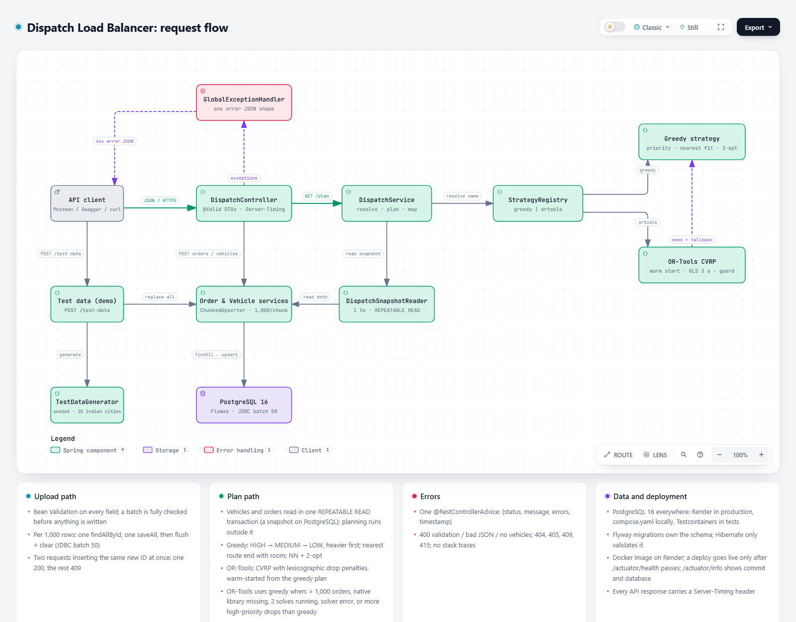

# Dispatch Load Balancer

**A Spring Boot service that turns delivery orders and a vehicle fleet into an optimized,
capacity-safe, priority-aware dispatch plan.**


| Resource | Link |
|---|---|
| **Live API** | https://dispatch-load-balancer-yl5j.onrender.com (opens Swagger UI) |
| **Postman collection** | [`postman/DispatchLoadBalancer.postman_collection.json`](postman/DispatchLoadBalancer.postman_collection.json) |
| **Video walkthrough** | [Loom: approach, live API demo in Swagger, design decisions](https://www.loom.com/share/86028ada1be14869888942c3452ec4fc) |
| **Architecture diagram** | [`docs/architecture.html`](docs/architecture.html) (interactive) |

## Contents

- [How to evaluate](#how-to-evaluate)
- [Overview](#overview)
- [Run locally](#run-locally)
- [Architecture](#architecture)
- [API at a glance](#api-at-a-glance)
- [How dispatching works](#how-dispatching-works)
- [Results on the live deployment](#results-on-the-live-deployment)
- [Tests and coverage](#tests-and-coverage)
- [Deployment](#deployment)
- [Tech stack](#tech-stack)
- [Project structure](#project-structure)
- [Assumptions](#assumptions)
- [Known limitations](#known-limitations)
- [Further documentation](#further-documentation)

## How to evaluate

### 1. Run the Postman collection against the live server (recommended)

1. In Postman, choose **Import** and select
   [`postman/DispatchLoadBalancer.postman_collection.json`](postman/DispatchLoadBalancer.postman_collection.json).
   The `baseUrl` variable already points at the live deployment.
2. Open the collection and click **Run** to run all **74 requests** in order. Every request carries
   tests, **398 assertions** in total. The latest full run against the live server passed all of them.
3. On top of the per-request tests, a collection-level script verifies **every dispatch plan** the
   server returns, independently of the server's own code:
   - no vehicle carries more than its capacity, and `totalLoad` equals the sum of the assigned weights;
   - every `totalDistance` matches a Haversine calculation done inside Postman, to within 0.01 km;
   - every uploaded order comes back exactly once, assigned or unassigned with a reason;
   - every assigned order includes its address;
   - no unassigned order would still have fitted a vehicle (the priority rule).

| Folder | What it checks |
|---|---|
| 0. Start here | Wakes the service: after 15 idle minutes the first request can take up to about 2 minutes |
| 1. Assignment example | The exact request and response example from the assignment brief |
| 2. Sample dataset | The brief's 30 orders and 5 vehicles with greedy, OR-Tools and the default strategy |
| 3. Upsert | Re-posting an existing `orderId` updates it instead of duplicating it |
| 4. Validation and error handling | 19 invalid inputs: 400/404/405/415 with one consistent error body |
| 5. Edge cases | An order too heavy for any vehicle, an exact-capacity fit, no vehicles, no orders |
| 6. Performance | 1,000, 10,000 and 20,000 orders uploaded and planned, with timings |
| 7. Test-data generator | One-call generation of 5,000 orders x 100 vehicles, and its limits |
| 8. Operations | Health check, OpenAPI document, root URL |
| 9. Restore sample data | Leaves the sample dataset loaded for the next reviewer |

To test a local run instead, set the collection variable `baseUrl` to `http://localhost:8080`.

### 2. Try it in Swagger UI

Open https://dispatch-load-balancer-yl5j.onrender.com. It redirects to Swagger UI, grouped in the order
you use the API: **Dispatch** (upload orders, upload vehicles, compute the plan), **Reset** (delete the
stored data) and **Test data (demo)**. Every endpoint has ready-made examples ("Assignment example" and
"Sample dataset (Delhi NCR)") under **Try it out**, and every documented error has a real example body.

### 3. Build and test the code

```bash
./mvnw verify      # JUnit suite + JaCoCo report in target/site/jacoco/index.html (Windows: .\mvnw.cmd verify)
```

### Where each evaluation criterion is addressed

| Criterion | How it is met | Verify it |
|---|---|---|
| Java, REST, testable by Postman, no UI | Java 21 / Spring Boot REST API; Postman suite included | Postman, all folders |
| Design patterns and refactoring | Strategy and registry, DTO and mapper, template method, adapter, fallback, bulkhead | [docs/DESIGN.md](docs/DESIGN.md#design-patterns) |
| API documentation and how to run | Swagger UI on the live server, this README, [docs/API.md](docs/API.md), [docs/OPERATIONS.md](docs/OPERATIONS.md) | Live URL |
| TDD, JUnit and test coverage | 1,148 JUnit tests, all against a real PostgreSQL 16; 98.0% line coverage, 85% gate enforced by the build | `./mvnw verify`, [docs/TESTING.md](docs/TESTING.md) |
| Efficient database operations | PostgreSQL 16 in production with Flyway migrations; chunked upsert: one `SELECT` per 1,000 rows, then batched `INSERT`/`UPDATE`; proven by tests that count SQL statements | Postman folders 3 and 6, `/actuator/info` |
| Code quality and structure | Layered packages, thin controllers, entities never leave the service layer | [Project structure](#project-structure) |
| Error handling | Strict validation, one error shape, no stack traces, unassignable orders reported with a reason | Postman folders 4 and 5 |
| Performance on large datasets | 20,000 orders uploaded in one request and planned on the live server (50,000 in a one-off run) | Postman folder 6, [docs/PERFORMANCE.md](docs/PERFORMANCE.md) |
| Correctness: constraints and distances | Capacity, priority and Haversine distance verified for every plan the server returns | Postman, collection-level checks |

## Overview

The service solves a **Capacitated Vehicle Routing Problem (CVRP)** through a REST API:

- **Capacity is a hard constraint.** No vehicle is ever loaded beyond its capacity.
- **Priority is respected.** HIGH orders are placed before MEDIUM, and MEDIUM before LOW.
- **Distance is minimized.** Distances use the Haversine formula, and routes are open (no return trip).
- **Nothing is silently lost.** Orders that cannot fit are returned in `unassignedOrders` with a reason
  instead of failing the request.

Two interchangeable algorithms are available per request: a fast, deterministic **greedy** heuristic
(the default) and a **Google OR-Tools** CVRP solver (`?strategy=ortools`).

## Run locally

Requires **JDK 21** and **Docker**; the Maven wrapper downloads everything else.

```bash
docker compose up -d              # local PostgreSQL 16 (compose.yaml)
./mvnw spring-boot:run            # Windows: .\mvnw.cmd spring-boot:run
```

Then open http://localhost:8080, or use curl from the project root:

```bash
curl -X POST localhost:8080/api/dispatch/orders   -H "Content-Type: application/json" -d @samples/orders.json
curl -X POST localhost:8080/api/dispatch/vehicles -H "Content-Type: application/json" -d @samples/vehicles.json
curl "localhost:8080/api/dispatch/plan"                     # greedy (default)
curl "localhost:8080/api/dispatch/plan?strategy=ortools"    # OR-Tools
```

PostgreSQL is the only database, locally, in the tests and in production, and Flyway migrations create
the schema. Configuration and deployment are covered in [docs/OPERATIONS.md](docs/OPERATIONS.md).

## Architecture

[](docs/architecture.html)

The architecture is layered:
- **Controllers** are thin: they validate the request DTOs and delegate to services.
- **Uploads** go through one shared chunked upserter.
- **Plans** are built by `DispatchService`, which resolves a strategy from the registry, reads vehicles
  and orders from one consistent database snapshot, runs the algorithm outside any transaction and
  maps the result to a response DTO.
- **Errors** from anywhere pass through a single `@RestControllerAdvice`, and JPA entities never leave
  the service layer.

The interactive diagram ([`docs/architecture.html`](docs/architecture.html), light/dark theme) traces
every path. The component view, package layout and design patterns are in [docs/DESIGN.md](docs/DESIGN.md).

## API at a glance

Base path `/api/dispatch`, JSON in and out.

| Endpoint | Purpose |
|---|---|
| `POST /orders` | Upsert delivery orders by `orderId` (`{"orders": [...]}`) |
| `POST /vehicles` | Upsert vehicles by `vehicleId` (`{"vehicles": [...]}`) |
| `GET /plan?strategy=greedy\|ortools` | Compute the dispatch plan (`greedy` by default) |
| `DELETE /orders`, `DELETE /vehicles` | Clear stored data |
| `POST /test-data?orders=&vehicles=&seed=` | Generate a reproducible dataset around 30 Indian cities (demo) |
| `GET /actuator/health` | Health check |

A plan lists every vehicle with its load, distance and orders in visiting order, plus any unassigned
orders with a reason:

```json
{
  "dispatchPlan": [
    { "vehicleId": "VEH001", "totalLoad": 100, "totalDistance": "14.44 km",
      "assignedOrders": [ { "orderId": "ORD026", "...": "...", "priority": "HIGH" } ] }
  ],
  "unassignedOrders": [
    { "orderId": "ORD003", "...": "...", "priority": "LOW",
      "reason": "Insufficient remaining capacity across fleet" }
  ],
  "strategy": "greedy"
}
```

Every error has the same shape, for example:

```json
{"status": "error", "message": "Validation failed",
 "errors": ["orders[0].latitude: must be less than or equal to 90.0"], "timestamp": "2026-11-12T10:15:30.123Z"}
```

Every API response also carries a `Server-Timing` header with the server's processing time. Field
rules, status codes and curl examples for every case are in [docs/API.md](docs/API.md).

## How dispatching works

**Greedy (default).** The steps are:
1. Sort orders by priority, then heavier first, then `orderId`.
2. Give each order to the vehicle with room whose route currently ends nearest to it; ties go to the
   smaller `vehicleId`.
3. Improve each route with nearest-neighbour and 2-opt, capped at 1,000 passes and 25 ms per vehicle.

Because every HIGH order is placed before any MEDIUM or LOW order, a lower priority can never take
capacity from a higher one. The algorithm is deterministic, and the HIGH-first rule is verified on
randomized data.

**OR-Tools.** The model is built as follows:
- **Open routes.** There is one start node per vehicle, plus a shared zero-cost end node.
- **Capacity.** A capacity dimension enforces each vehicle's limit.
- **Lexicographic drop penalties.** Dropping one HIGH order costs more than dropping every MEDIUM and
  LOW order plus any distance.

The search starts from the greedy plan and runs Guided Local Search for 3 s. If it would leave more
high-priority orders unassigned than greedy, the greedy plan is returned. The response falls back to
greedy, and says so in `strategy`, in these cases:
- more than 1,000 orders;
- the native library is unavailable;
- two solves are already running;
- the solver fails.

The full description, including the penalty formulas and the complexity analysis, is in
[docs/ALGORITHMS.md](docs/ALGORITHMS.md).

## Results on the live deployment

All figures come from the Postman runs against https://dispatch-load-balancer-yl5j.onrender.com,
which runs on PostgreSQL 16. `GET /actuator/info` shows the database and the deployed commit.

**Sample dataset from the brief.** It has 30 orders and 5 vehicles, and is an intentional
over-capacity case: 645 kg of orders against 500 kg of capacity.

| | Greedy | OR-Tools (3 s search) |
|---|---|---|
| Orders assigned | 22 of 30 | 24 of 30 |
| HIGH / MEDIUM assigned | 12 of 12 / 8 of 8 | 12 of 12 / 8 of 8 |
| Unassigned (all LOW, each with a reason) | 8 | 6 |
| Total distance | **73.42 km** | **48.27 km** |
| Capacity respected | Yes, every vehicle | Yes, every vehicle |

**Large datasets.** These ran on Render's free instances, with a 0.1 share of one CPU and 512 MB RAM,
writing to PostgreSQL. Server times are from the `Server-Timing` header, measured on a warm instance
during a repeat run.

| Orders x Vehicles | Upload orders to PostgreSQL (server) | Greedy plan (server) | Greedy plan (end-to-end, incl. download) |
|---|---:|---:|---:|
| 1,000 x 50 | 0.6 s | 0.2 s | 0.4 s |
| 10,000 x 200 | 5.8 s | 0.7 s | 2.3 s |
| 20,000 x 400 | 8.1 s (2.7 MB body, one request) | 1.2 s | 2.6 s (3.6 MB response) |

OR-Tools plans 1,000 x 50 in 4.4 s (a 3 s search plus model building). Stored data survives restarts:
the sample dataset gave the same plan after the service was restarted. First-run figures and the method
are in [docs/PERFORMANCE.md](docs/PERFORMANCE.md).

## Tests and coverage

| JUnit tests | Line coverage | Branch coverage | Build gate |
|---|---|---|---|
| **1,148** passing | **98.00%** | **87.80%** | `./mvnw verify` fails below 85% line coverage |

Every Spring test runs against a real PostgreSQL 16, which Testcontainers creates for the run and removes
afterwards, so the tests exercise the production database engine. Docker must be running.

The suite is built test-first with JUnit 5, Mockito, MockMvc and AssertJ. It covers:
- every validation rule and exact error message;
- the HIGH-priority invariant on randomized data;
- the exact sample routes (73.42 km);
- every OR-Tools fallback and the concurrency bulkhead;
- JDBC batching, proven by counting the real SQL statements;
- the configuration, bound exactly as at start-up with the variables Render injects;
- consistent plans: an upload committed while a plan is being read never ends up half in it;
- applied database migrations can never be edited by mistake.

The Postman collection adds 398 assertions over HTTP against the live server. See
[docs/TESTING.md](docs/TESTING.md).

## Deployment

- **Infrastructure as code.** [`render.yaml`](render.yaml) declares the PostgreSQL 16 database and the
  Docker web service in the same region. Render injects the database host and credentials into the
  service, so no secret is stored in the repository.
- **Schema.** [Flyway](src/main/resources/db/migration) migrations with primary keys and `CHECK`
  constraints create the schema. Hibernate only validates it (`ddl-auto: validate`).
- **Release process.**
  1. `./mvnw verify` runs all 1,148 tests against PostgreSQL 16.
  2. Deploy the commit from the Render dashboard (**Manual Deploy > Deploy latest commit**). A version
     only goes live after it passes the `/actuator/health` check, so a broken build never replaces a
     working one.
  3. Confirm the release: `/actuator/info` shows the deployed commit and the database, and the Postman
     collection runs against the live server.

## Tech stack

| Area | Technology |
|---|---|
| Language and framework | Java 21, Spring Boot 3.5.16 (Web, Data JPA, Validation, Actuator) |
| Optimization | Google OR-Tools 9.15 (routing solver, native libraries loaded lazily) |
| Persistence | PostgreSQL 16 (Render in production, `compose.yaml` locally, Testcontainers in tests), Flyway migrations, Hibernate 6.6, HikariCP |
| API documentation | springdoc-openapi 2.10 (Swagger UI) |
| Testing | JUnit 5, Mockito, MockMvc, AssertJ, JaCoCo 0.8.16, Postman |
| Build and delivery | Maven Wrapper, multi-stage Docker image (`eclipse-temurin:21-jre-jammy`), Render Blueprint |

## Project structure

```text
dispatch-load-balancer/
├── src/
│   ├── main/
│   │   ├── java/com/freightfox/dispatch/   Application source (packages below)
│   │   └── resources/                      application.yml, db/migration (Flyway)
│   └── test/
│       ├── java/com/freightfox/dispatch/   Unit, integration, end-to-end and benchmark tests
│       └── resources/                      Sample datasets and CVRPLIB benchmark instances
├── docs/                                   API, algorithms, design, operations, testing, performance
├── postman/                                Evaluation suite: 74 requests, 398 assertions
├── samples/                                Ready-to-use request bodies (Delhi NCR dataset)
├── Dockerfile                              Multi-stage, non-root image (JRE 21)
├── render.yaml                             Render Blueprint: PostgreSQL database + Docker web service
├── compose.yaml                            Local PostgreSQL 16 for running on a laptop
└── pom.xml                                 Maven build with JaCoCo 85% coverage gate
```

Source packages under `com.freightfox.dispatch`, by layer:

| Layer | Package | Responsibility |
|---|---|---|
| **API** | `controller` | REST endpoints, API constants, Swagger examples, `Server-Timing` header |
| | `dto.request` / `dto.response` | Validated request records and response records |
| | `exception` | Global exception handler: one error format for every failure |
| **Application** | `service`, `service.impl` | Order, vehicle and dispatch services; shared chunked upserter |
| | `mapper` | Request-to-entity and result-to-response mapping |
| **Algorithms** | `strategy` | `DispatchStrategy` contract and the plan result model |
| | `strategy.registry` | Strategy lookup by name, with no if/else on the strategy |
| | `strategy.greedy` | Priority-first assignment, nearest-neighbour and 2-opt route improvement |
| | `strategy.ortools` | CVRP model builder, drop penalties, solver adapter, lazy native loader |
| | `distance` | Haversine calculator and precomputed trigonometry table |
| **Persistence** | `entity`, `repository` | JPA entities and Spring Data repositories |
| **Support** | `config` | Typed configuration properties and OpenAPI metadata |
| | `testdata` | Seeded test-data generator around 30 Indian cities |

## Assumptions

- **Routes:** routes are open (they end at the last stop); distances are great-circle (Haversine,
  R = 6371 km), not road distances; there are no time windows.
- **Units:** weights and capacities are whole numbers, such as kg. `10.5` is rejected rather than
  truncated.
- **POST behaviour:** each POST is an all-or-nothing upsert. The whole batch is validated first; existing
  IDs are updated, new IDs are inserted, and IDs not in the request are left untouched.
- **Priority input:** `priority` is case-insensitive; numeric values are rejected.
- **Plans:** a plan is computed on demand and never stored. An unknown strategy or an empty fleet
  returns 400.
- **Unassigned orders:** they are reported, never dropped silently.

The full list of decisions is in [docs/DESIGN.md](docs/DESIGN.md#assumptions-and-decisions).

## Known limitations

- **OR-Tools results can vary.** The search is time-limited, so results can differ slightly between
  runs. Capacity and priority constraints always hold.
- **OR-Tools scope is capped.** It handles up to 1,000 orders and 2 concurrent solves; beyond that the
  service uses greedy and reports `"strategy": "greedy"`.
- **Greedy is a heuristic.** It guarantees capacity and priority order, but not minimum distance or
  maximum orders served.
- **Free-tier hosting.** The live web service sleeps when idle; its first request can take up to about
  2 minutes, and it has a small CPU share. Render's free PostgreSQL plan expires on 13 December 2026,
  after the evaluation window; a paid plan removes both limits.
- **The API is open.** There is no authentication, deliberately, so reviewers can test it without
  credentials. Anyone can therefore delete the stored data or regenerate the test data; the Postman
  collection's last folder restores the sample dataset. A real deployment would put an API key or OAuth
  in front of the write and delete endpoints.
- **Request size is not capped in the application.** For public exposure, put a body-size limit in a
  reverse proxy.

## Further documentation

| Document | Contents |
|---|---|
| [docs/API.md](docs/API.md) | Endpoints, field rules, response and error formats, status codes, curl examples |
| [docs/ALGORITHMS.md](docs/ALGORITHMS.md) | Haversine, greedy, OR-Tools model and penalties, fallbacks, sample walk-through |
| [docs/DESIGN.md](docs/DESIGN.md) | Component diagram, package layout, design patterns, assumptions and decisions, scaling |
| [docs/OPERATIONS.md](docs/OPERATIONS.md) | Running locally, PostgreSQL, Docker, configuration, Render deployment |
| [docs/TESTING.md](docs/TESTING.md) | JUnit suite, Postman evaluation suite, what each test area proves |
| [docs/PERFORMANCE.md](docs/PERFORMANCE.md) | Measurements on the live deployment |
