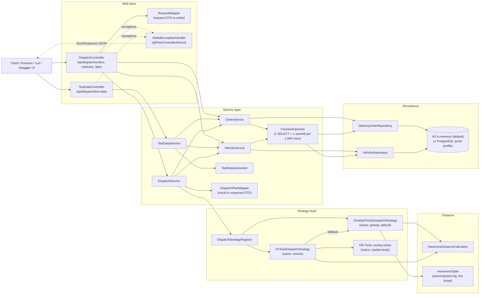

# Dispatch Load Balancer

A Spring Boot REST service that assigns delivery orders to a fleet of vehicles and returns an optimized
dispatch plan. This is a **Capacitated Vehicle Routing Problem** (CVRP): no vehicle may carry more than
its capacity, HIGH priority orders are placed before MEDIUM and MEDIUM before LOW, and total travel
distance is minimized. Distances between coordinates use the **Haversine** formula (Earth radius
6371.0 km). Two interchangeable algorithms are available: a fast deterministic **greedy** heuristic
(the default) and a **Google OR-Tools** CVRP solver (`?strategy=ortools`). Orders that cannot be placed
are returned with a reason instead of failing the request. The service has no UI: it is a pure REST
API, documented with Swagger/OpenAPI and testable with Postman or curl.

- Live URL: <TBD - add Render URL>
- Swagger UI: <live-url>/swagger-ui.html (locally: http://localhost:8080/swagger-ui.html)
- OpenAPI spec: <live-url>/v3/api-docs
- Loom video: <TBD - add Loom link>
- Postman collection: [`postman/DispatchLoadBalancer.postman_collection.json`](postman/DispatchLoadBalancer.postman_collection.json)

## Contents

1. [Tech stack](#tech-stack)
2. [Architecture](#architecture)
3. [Package structure and design patterns](#package-structure-and-design-patterns)
4. [API reference](#api-reference)
5. [Algorithms](#algorithms)
6. [Sample dataset walk-through](#sample-dataset-walk-through)
7. [Assumptions and decisions](#assumptions-and-decisions)
8. [How to run locally](#how-to-run-locally)
9. [Configuration](#configuration)
10. [Tests and coverage](#tests-and-coverage)
11. [Performance and Scalability](#performance-and-scalability)
12. [curl examples](#curl-examples)
13. [Deploy to Render](#deploy-to-render)
14. [Known limitations](#known-limitations)

## Tech stack

| Area | Technology | Version |
|---|---|---|
| Language | Java | 21 |
| Framework | Spring Boot (Web, Data JPA, Validation, Actuator) | 3.5.16 |
| Build | Maven via the Maven Wrapper (`mvnw` / `mvnw.cmd`) | Maven 3.10.0 (wrapper 3.3.4) |
| Persistence | Hibernate ORM (managed by Spring Boot) | 6.6.53.Final |
| Database (default) | H2, in-memory, PostgreSQL compatibility mode | 2.3.232 |
| Database (`prod` profile) | PostgreSQL JDBC driver | 42.7.11 |
| API docs | springdoc-openapi (Swagger UI) | 2.10.0 |
| Optimization | Google OR-Tools Java (`com.google.ortools:ortools-java`) | 9.15.6755 |
| Testing | JUnit 5, Mockito, MockMvc, AssertJ (`spring-boot-starter-test`) | managed by Spring Boot |
| Coverage | JaCoCo (85% line coverage gate on `verify`) | 0.8.16 |
| Runtime image | `eclipse-temurin:21-jre-jammy` (glibc, required by the OR-Tools native libraries) | - |

Library versions other than those pinned in `pom.xml` are the ones Spring Boot 3.5.16 resolves (as
packaged in `target/dispatch-load-balancer-1.0.0.jar`).

## Architecture



Request flow for `GET /api/dispatch/plan`: the controller passes the `strategy` parameter to
`DispatchService`, which resolves the strategy in the registry (unknown name: 400), loads vehicles
(none: 400) and orders, runs the algorithm outside any transaction, and maps the internal
`DispatchResult` to the response DTO. The plan is computed on demand and never persisted.

## Package structure and design patterns

```
com.freightfox.dispatch
|-- DispatchLoadBalancerApplication   Spring Boot entry point (@ConfigurationPropertiesScan)
|-- config        Typed settings (DispatchProperties: app.dispatch.*, TestDataProperties: app.test-data.*) and OpenAPI metadata
|-- controller    Thin REST controllers, API paths/messages (ApiMessages) and Swagger examples (OpenApiExamples)
|-- distance      DistanceCalculator interface, HaversineDistanceCalculator, HaversineTable (trig-free hot-loop distances)
|-- dto
|   |-- request   Validated request records (OrdersRequest, OrderRequest, VehiclesRequest, VehicleRequest)
|   `-- response  Response records (StatusResponse, ErrorResponse, DispatchPlanResponse, VehiclePlanResponse, ...)
|-- entity        JPA entities DeliveryOrder and Vehicle (String primary keys, Persistable) and enum Priority
|-- exception     BadRequestException hierarchy, ErrorMessages constants, GlobalExceptionHandler, JSON error translation
|-- mapper        RequestMapper (DTO to entity) and DispatchPlanMapper (DispatchResult to response DTO)
|-- repository    Spring Data JPA repositories
|-- service       Service interfaces (OrderService, VehicleService, DispatchService) and UpsertResult
|   `-- impl      Default implementations and ChunkedUpserter (shared chunked upsert)
|-- strategy      DispatchStrategy contract, DispatchResult, VehicleRoute, UnassignedOrder, StrategyNames, UnassignmentReasons
|   |-- greedy    GreedyPriorityDispatchStrategy, CapacityAssigner, RouteOptimizer (nearest-neighbour + 2-opt), DispatchOrdering
|   |-- ortools   OrToolsDispatchStrategy, CvrpModelBuilder, CvrpModel, DropPenalties, OrToolsCvrpSolver, OrToolsNativeLoader, ...
|   `-- registry  DispatchStrategyRegistry (strategy lookup by name)
`-- testdata      TestDataGenerator (30 Indian cities, seeded Random), TestDataService, IndianCity
```

Other top-level files: `samples/` (ready-to-use request bodies), `postman/` (collection), `Dockerfile`,
`.dockerignore`, `render.yaml`, `docs/PERFORMANCE.md` (generated by the performance profile).

Design patterns actually used in the code:

| Pattern | Where |
|---|---|
| Strategy | `DispatchStrategy` with `GreedyPriorityDispatchStrategy` and `OrToolsDispatchStrategy`; `DistanceCalculator` with `HaversineDistanceCalculator`. |
| Registry | `DispatchStrategyRegistry` is built from every `DispatchStrategy` bean and looks them up by case-insensitive name. Adding an algorithm means adding one bean; there is no if/else on the strategy anywhere. |
| DTO + Mapper | Java records for requests and responses; `RequestMapper` and `DispatchPlanMapper` keep JPA entities out of the API. |
| Repository | Spring Data JPA `DeliveryOrderRepository` and `VehicleRepository`. |
| Template method (by composition) | `ChunkedUpserter` owns the fixed upsert algorithm (reject duplicates, then per chunk: one `findAllById`, merge, one `saveAll`, flush, clear); each service supplies a `ChunkedUpserter.Target` (repository, update function, field names). |
| Fallback / graceful degradation | `OrToolsDispatchStrategy` receives the greedy strategy as its fallback and uses it when the order count exceeds the cap, the native library cannot load, no solution is found, or the solver output fails the safety re-check. |
| Empty-route object | `VehicleRoute.empty(vehicle)`: unused vehicles always get a valid zero route rather than null. |
| Builder | `CvrpModelBuilder` assembles the immutable `CvrpModel` (node layout, metre matrix, demands, capacities, penalties). |
| Adapter / seam | `CvrpSolver` interface with `OrToolsCvrpSolver` adapting the OR-Tools routing API to plain Java `CvrpModel` / `CvrpSolution`; tests replace it to exercise every fallback. |
| Lazy initialization | `OrToolsNativeLoader` loads the native libraries on first use, once, thread-safe, and caches failure, so application start-up never depends on them. |
| Centralized error handling | One `@RestControllerAdvice` (`GlobalExceptionHandler`) and an exception hierarchy rooted at `BadRequestException`. |
| Static factory methods | `StatusResponse.success(...)`, `ErrorResponse.of(...)`, `TestDataResponse.success(...)`. |

Other conventions: constructor injection only, records for DTOs, all API strings in constants
(`ApiMessages`, `ErrorMessages`, `UnassignmentReasons`, `StrategyNames`), SLF4J logging.

## API reference

Base path: `/api/dispatch`. All bodies are JSON (`Content-Type: application/json`).

| Method and path | Parameters / body | Success (200) | Error cases |
|---|---|---|---|
| `POST /api/dispatch/orders` | Body `{"orders": [ ... ]}` (see field rules below). Upsert by `orderId`. | `{"message": "Delivery orders accepted.", "status": "success"}` | 400 validation error, invalid priority, wrong type (e.g. `10.5`), duplicate `orderId`, malformed JSON, missing body; 415 wrong content type |
| `POST /api/dispatch/vehicles` | Body `{"vehicles": [ ... ]}`. Upsert by `vehicleId`. | `{"message": "Vehicle details accepted.", "status": "success"}` | Same as above, for vehicles |
| `GET /api/dispatch/plan` | Query `strategy` (optional): `greedy` (default) or `ortools`; case-insensitive, trimmed; blank means `greedy`. | Dispatch plan (below) | 400 unknown strategy; 400 no vehicles stored. No orders stored: 200 with every vehicle empty |
| `DELETE /api/dispatch/orders` | - | `{"message": "All delivery orders deleted.", "status": "success"}` | - |
| `DELETE /api/dispatch/vehicles` | - | `{"message": "All vehicles deleted.", "status": "success"}` | - |
| `POST /api/dispatch/test-data` | Query `orders` (default 5000, 1 to 50000), `vehicles` (default 100, 1 to 2000), `seed` (default 42). Demo/testing only; **replaces** all orders and vehicles. | `{"message": "Test data generated. All existing orders and vehicles were replaced.", "status": "success", "ordersGenerated": 5000, "vehiclesGenerated": 100, "seed": 42, "elapsedMs": ...}` | 400 out of range or not a number; 404 when `app.test-data.enabled=false` |
| `GET /actuator/health` | - | `{"status": "UP"}` | - |
| `GET /v3/api-docs` | - | OpenAPI 3 JSON | - |
| `GET /swagger-ui.html` | - | Swagger UI with preloaded examples ("Assignment example", "Sample dataset (Delhi NCR)") | - |

### Field rules

| Field | Rule |
|---|---|
| `orders` / `vehicles` | Required, not empty, no `null` elements |
| `orderId` / `vehicleId` | Not blank, at most 64 characters, unique within the request |
| `latitude` / `currentLatitude` | Required number, -90 to 90 |
| `longitude` / `currentLongitude` | Required number, -180 to 180 |
| `address` / `currentAddress` | Not blank, at most 500 characters |
| `packageWeight` / `capacity` | Required whole number, greater than 0 (`10.5` is rejected, not truncated) |
| `priority` | Required, one of `HIGH`, `MEDIUM`, `LOW` (case-insensitive; numbers such as `1` are rejected) |

### Plan response

```json
{
  "dispatchPlan": [
    {
      "vehicleId": "VEH001",
      "totalLoad": 10,
      "totalDistance": "5.06 km",
      "assignedOrders": [
        {"orderId": "ORD001", "latitude": 12.9716, "longitude": 77.5946,
         "address": "MG Road, Bangalore, Karnataka, India", "packageWeight": 10, "priority": "HIGH"}
      ]
    }
  ],
  "unassignedOrders": [],
  "strategy": "greedy"
}
```

- Every stored vehicle is listed, sorted by `vehicleId`; unused vehicles have `totalLoad` 0,
  `totalDistance` `"0.00 km"` and an empty `assignedOrders` list.
- `assignedOrders` are in actual visiting order. `totalDistance` is a string with two decimals.
- `unassignedOrders` (an allowed addition) lists every order that could not be placed, with all order
  fields plus `reason`, sorted HIGH first, then by `orderId`. Reasons:
  - `Package weight exceeds capacity of every vehicle`
  - `Insufficient remaining capacity across fleet` (greedy)
  - `Dropped by optimizer: insufficient capacity` (OR-Tools)
- `strategy` (an allowed addition) names the algorithm that actually ran. It is `greedy` when
  `ortools` was requested but fell back (see [OR-Tools](#or-tools-cvrp-strategy)).

### Error response

Every error, from any endpoint, has one shape:

```json
{
  "status": "error",
  "message": "Validation failed",
  "errors": ["orders[0].latitude: must be less than or equal to 90.0"],
  "timestamp": "2026-11-12T10:15:30.123Z"
}
```

- `errors` entries are `"field: reason"`; validation errors are sorted alphabetically and use the
  standard Bean Validation (Hibernate Validator) English messages.
- At most 100 entries are returned, followed by `"... and N more errors"`. Client values echoed in
  messages are cut to 64 characters.
- No stack traces or exception class names are ever returned; unexpected faults are logged server-side
  and answered with `500` and `"An unexpected error occurred"`.

### Status codes

| Code | When |
|---|---|
| 200 | Success |
| 400 | Any invalid input: validation, wrong JSON type, invalid enum value, malformed or missing body, duplicate IDs, unknown strategy, no vehicles for a plan, test-data parameters out of range or not numeric |
| 404 | Unknown path (`"Resource not found"`, e.g. `"path: no endpoint GET /api/dispatch/nothing-here"`), or the test-data endpoint when disabled |
| 405 | Wrong method (`"Request method 'PUT' is not supported for this endpoint"`, `"supported methods: DELETE, POST"`), with an `Allow` header |
| 406 | The `Accept` header allows no JSON (no body) |
| 409 | Two concurrent requests inserting the same new ID (`"The request conflicts with data that was changed concurrently; please retry"`) |
| 415 | Non-JSON content type (`"Content type 'text/plain' is not supported"`) |
| 500 | Genuine server faults only; never for bad input |

## Algorithms

### Haversine distance

```
h = sin^2(dLat / 2) + cos(lat1) * cos(lat2) * sin^2(dLon / 2)
d = 2 * R * asin(sqrt(h)),   R = 6371.0 km
```

`h` is clamped to [0, 1]. Because `d` is strictly increasing in `h`, hot loops compare `h` directly.
`HaversineTable` precomputes the half-angle sines and cosines of every point, so the greedy inner loop
evaluates distances without any trigonometric call or allocation. Connaught Place to Karol Bagh
(Delhi) is about 14.44 km.

### Greedy strategy (default, `strategy=greedy`)

1. **Sort** orders by priority (HIGH, MEDIUM, LOW), then `packageWeight` descending (heavier first:
   large packages are the hardest to fit), then `orderId`. Fully deterministic.
2. **Track** each vehicle's remaining capacity and route end; the route end starts at the vehicle's
   current location.
3. **Assign** each order, in that sequence, to the vehicle with enough remaining capacity whose route
   end is nearest (cheapest insertion at the route end). Ties go to the smaller `vehicleId`. The
   vehicle's route end then moves to the order.
4. **Unassigned**: if no vehicle has room, the order is reported with `Package weight exceeds capacity
   of every vehicle` (heavier than the largest vehicle) or `Insufficient remaining capacity across
   fleet`. An order whose weight equals a vehicle's capacity fits that empty vehicle.
5. **Improve each route**: nearest-neighbour ordering from the vehicle start (kept only if shorter),
   then first-improvement 2-opt on the open path (a move is kept only if it shortens the route).
   2-opt is capped by `app.dispatch.greedy.two-opt-max-iterations` (1000 passes) and
   `app.dispatch.greedy.two-opt-time-budget` (25 ms per vehicle). A final guard keeps the assignment
   order if the optimized sequence is not shorter.
6. **Distance** is the open route: vehicle location -> stop 1 -> ... -> last stop (no return trip),
   computed with `HaversineDistanceCalculator`.

**HIGH-priority guarantee.** All HIGH orders are placed before any MEDIUM or LOW order, so MEDIUM and
LOW orders can never take capacity from a HIGH order. An unassigned HIGH order is therefore heavier
than every vehicle's remaining capacity after only the HIGH orders were placed. This invariant is
tested on randomized data (`GreedyRandomizedInvariantTest`).

**Complexity** (n orders, m vehicles, k stops on one route):

| Step | Cost |
|---|---|
| Sort | O(n log n) |
| Assignment | O(n * m), allocation-free, trig-free inner loop; O(n + m) extra memory |
| Nearest-neighbour per route | O(k^2); skipped above 10,000 stops |
| 2-opt per route | O(k^2) per pass, at most 1000 passes and 25 ms per vehicle |
| Distance matrix per route | Precomputed for routes up to 1,024 points (at most 8 MB), evaluated on the fly above that |

Measured on the lead's machine: 50,000 orders x 500 vehicles planned in about 0.5 s cold and 0.14 s
warm; 10,000 x 200 in about 11 ms (see also [Performance and Scalability](#performance-and-scalability)).

### OR-Tools CVRP strategy (`strategy=ortools`)

`OrToolsDispatchStrategy` models the same problem as a Capacitated Vehicle Routing Problem for the
Google OR-Tools routing solver.

- **Nodes**: `0 .. V-1` one start node per vehicle (its current location), `V .. V+N-1` one node per
  order, and `V+N` **one dummy end node shared by all vehicles**. Every arc into and out of the dummy
  end costs 0, which turns the closed tours of a classic CVRP into **open routes** (no return trip),
  matching the greedy distance definition.
- **Arc costs**: a `(V+N+1)^2` matrix of Haversine distances in whole metres
  (`Math.round(km * 1000)`), one evaluator for every vehicle.
- **Capacity dimension**: demand = `packageWeight` per order node (0 for start and end nodes), per
  vehicle capacity, no slack, cumul starts at 0.
- **Optional visits**: every order node is a single-node disjunction with a drop penalty by priority.
- **Search**: `PATH_CHEAPEST_ARC` first solution, then `GUIDED_LOCAL_SEARCH` until the time limit
  `app.dispatch.ortools.time-limit` (default 3 s). Guided Local Search uses the whole limit, so an
  OR-Tools plan takes about 3 s (plus about 0.9 s to load the native library on the first call).
- **Result**: dropped orders are reported with `Dropped by optimizer: insufficient capacity`. Loads
  and distances in km are recomputed from the real coordinates, and the solution is re-checked
  (capacity, each order at most once, one route per vehicle) before it is returned.

**Drop penalties (lexicographic objective).** The solver minimizes `total arc cost + sum of penalties
of dropped orders`. With `maxArc` the largest matrix entry, `routeBound = maxArc * (orders + vehicles)`
is an upper bound on the distance of any solution (every visited node has exactly one outgoing arc).
With `nLow` and `nMedium` the numbers of LOW and MEDIUM orders in the model:

```
LOW    = routeBound + 1
MEDIUM = LOW * nLow + routeBound + 1
HIGH   = MEDIUM * nMedium + LOW * nLow + routeBound + 1
```

Dropping one HIGH order therefore costs more than dropping every MEDIUM and LOW order plus any
possible distance; dropping one MEDIUM costs more than dropping every LOW order plus any distance; and
dropping one LOW costs more than any distance saving. The objective is lexicographic: first minimize
dropped HIGH orders, then MEDIUM, then LOW, and only then distance. Penalties count orders, not
weight, so the solver serves as many LOW orders as fit (even far ones) before it minimizes distance.
All penalty arithmetic uses exact (overflow-checked) operations; if the worst-case objective would not
fit in int64, the internal cost unit is coarsened (1 m, 10 m, 100 m, ...). Reported distances always
come from the real coordinates. The guarantee holds for the optimum; the solver is a heuristic, and in
the tests the local search reliably finds such solutions.

**Cap and fallbacks.** OR-Tools never causes a 500. The strategy logs a WARN and returns the greedy
plan (response `"strategy": "greedy"`) when:

- there are more orders than `app.dispatch.ortools.max-orders` (default 1,000; the matrix grows as N
  squared);
- the native library cannot be loaded (loaded lazily, so start-up never fails because of it);
- the solver finds no solution within the time limit;
- the solver throws, or its output fails the safety re-check.

Orders heavier than every vehicle are excluded from the model up front and reported with `Package
weight exceeds capacity of every vehicle`. With no orders, every vehicle gets an empty route without
calling the solver.

## Sample dataset walk-through

`samples/orders.json` and `samples/vehicles.json` (also in `src/test/resources/data/`) are a Delhi NCR
dataset: 30 orders at Connaught Place, Karol Bagh, Sector 18 Noida and Cyber Hub Gurgaon, and 5
vehicles. It is an intentional over-capacity edge case:

| | HIGH | MEDIUM | LOW | Total |
|---|---|---|---|---|
| Orders | 12 | 8 | 10 | 30 |
| Weight | 275 | 145 | 225 | **645** |

Fleet capacity: VEH001 100, VEH002 80, VEH003 120, VEH004 90, VEH005 110 = **500**. At least 145 units
cannot be delivered, so some LOW orders must be unassigned.

**Greedy result** (asserted by `GreedySampleDatasetTest`):

| Vehicle | Stops in visiting order | Load / capacity | Distance |
|---|---|---|---|
| VEH001 | ORD026, ORD007, ORD011, ORD015, ORD001 | 100 / 100 | 14.44 km |
| VEH002 | ORD020, ORD023, ORD027 | 80 / 80 | 0.00 km |
| VEH003 | ORD013, ORD005, ORD009, ORD017, ORD010 | 115 / 120 | 24.74 km |
| VEH004 | ORD029, ORD004, ORD008, ORD012 | 90 / 90 | 19.80 km |
| VEH005 | ORD018, ORD021, ORD025, ORD002, ORD006 | 105 / 110 | 14.44 km |

22 orders assigned (all 12 HIGH, all 8 MEDIUM, 2 LOW), **73.42 km** in total. Unassigned, all LOW with
`Insufficient remaining capacity across fleet`: ORD003, ORD014, ORD016, ORD019, ORD022, ORD024, ORD028,
ORD030.

**OR-Tools result** (3 s time limit, run on the lead's machine): 24 orders assigned (all 12 HIGH, all 8
MEDIUM, 4 LOW), **34.24 km** in total; the Karol Bagh -> Connaught Place -> Noida relay is the only
cross-city travel. Dropped, all LOW with `Dropped by optimizer: insufficient capacity`: ORD006, ORD010,
ORD014, ORD016, ORD022, ORD030. Because the penalties count orders, OR-Tools serves more (lighter) LOW
orders than greedy, which prefers heavier ones. With a 1 s limit on a cold JVM it can stop at a 48.27 km
local optimum, which is why 3 s is the default. `SampleDatasetIntegrationTest` asserts, for both
strategies, that all 12 HIGH orders are assigned, no vehicle is over capacity, assigned + unassigned =
30 and every unassigned order is LOW, and that OR-Tools is not longer than greedy.

## Assumptions and decisions

**Routes and distances**
- Routes are open: distance = vehicle location -> stop 1 -> ... -> last stop, with no return trip.
- Distances are great-circle (Haversine, R = 6371.0 km), not road distances.
- The plan is computed on demand and never persisted.

**Input and validation**
- Weights and capacities are whole numbers (int, e.g. kg). `10.5` is rejected with 400 rather than
  truncated.
- `priority` is case-insensitive (`"high"` is accepted); a number such as `1` is rejected.
- IDs and addresses are stored exactly as sent (case-sensitive IDs).
- Each POST is all-or-nothing: the whole batch is validated first; any invalid item or duplicate ID
  gives 400 and nothing is stored; the upsert runs in one transaction.
- Error lists are capped at 100 entries plus `"... and N more errors"`; echoed values are truncated to
  64 characters; validation errors are sorted alphabetically; messages are Hibernate Validator
  defaults (English).

**Upsert semantics**
- POSTing an existing ID replaces all of its fields; new IDs are inserted; IDs not in the request are
  left untouched (POST is additive, not a full replacement). Use DELETE to clear.
- Chunks of 1,000: per chunk one `findAllById`, `updateFrom()` on the managed rows (dirty checking,
  batched UPDATEs), one `saveAll` of the new rows (batched INSERTs), then flush and clear. Entities
  implement `Persistable<String>`, so new rows are persisted without a SELECT per row. Hibernate JDBC
  batching: `batch_size` 50, `order_inserts`, `order_updates`. DELETE is one bulk statement.
- `UpsertResult.updated` counts incoming IDs that already existed even if unchanged (Hibernate sends no
  SQL for unchanged rows).

**Plan endpoint**
- Strategy lookup is case-insensitive and trimmed; null or blank means `greedy`.
- Check order: strategy first (unknown gives 400 even with an empty database), then vehicles (none
  gives 400 `No vehicles available for dispatch`), then orders (none gives 200 with every vehicle
  listed empty with `"0.00 km"`).

**Greedy**
- Sort by priority, then heavier first (reduces fragmentation), then `orderId`.
- Nearest vehicle measured from its current route end; ties go to the smaller `vehicleId` (string
  order).
- Unassigned reason: `Package weight exceeds capacity of every vehicle` if heavier than the largest
  vehicle, otherwise `Insufficient remaining capacity across fleet`.
- An order whose weight equals a vehicle's capacity fits that (empty) vehicle.
- Deterministic, unless a 2-opt time budget runs out (only on very long routes).

**OR-Tools**
- Not strictly deterministic: the search is time-limited, so the plan can differ slightly between runs
  on a busy machine. The constraints (capacity, priorities, each order exactly once) always hold.
- The cap compares `max-orders` with the total number of orders; above it greedy runs and the response
  says `"strategy": "greedy"`.

**Test data**
- `POST /api/dispatch/test-data` REPLACES all stored orders and vehicles (delete orders, delete
  vehicles, upsert vehicles, upsert orders, through the same services; not one atomic transaction).
  Calls are serialized per instance with a lock. `elapsedMs` covers generate + clear + store, not
  planning.
- 30 real Indian city centres; points uniform within a 15 km disc; address `Near <City>, India`;
  priority drawn 30% HIGH / 40% MEDIUM / 30% LOW per order; weight 1 to 50 and capacity 100 to 500
  (inclusive); IDs `ORD000001...` and `VEH0001...`, which never collide with the sample IDs. The same
  seed always produces the same data.

**Operations**
- H2 in-memory is the default: all data is lost on restart or redeploy. The `prod` profile uses
  PostgreSQL (tip: append `?reWriteBatchedInserts=true` to `DB_URL`).
- The OpenAPI server URL is relative (`/`), so Swagger "Try it out" works locally, in Docker and on
  Render.
- Actuator exposes `health` only, without details.

## How to run locally

**Prerequisites:** JDK 21. Nothing else: Maven is downloaded by the wrapper on first use. All commands
are run from the project root.

```bash
# macOS / Linux / Git Bash
./mvnw spring-boot:run
```

```powershell
# Windows (PowerShell or cmd)
.\mvnw.cmd spring-boot:run
```

Or build the jar and run it:

```bash
./mvnw clean package          # add -DskipTests to skip the tests
java -jar target/dispatch-load-balancer-1.0.0.jar
```

The service listens on port 8080 (or `$PORT` if set). Open http://localhost:8080/swagger-ui.html.

**PostgreSQL (`prod` profile)**

```bash
export SPRING_PROFILES_ACTIVE=prod
export DB_URL="jdbc:postgresql://localhost:5432/dispatch?reWriteBatchedInserts=true"
export DB_USERNAME=dispatch
export DB_PASSWORD=secret
java -jar target/dispatch-load-balancer-1.0.0.jar
```

PowerShell: `$env:SPRING_PROFILES_ACTIVE="prod"; $env:DB_URL="jdbc:postgresql://..."; ...`. The `prod`
profile uses `ddl-auto: update`, so the tables are created on first start.

**Docker**

```bash
docker build -t dispatch-load-balancer .
docker run -p 8080:8080 dispatch-load-balancer
```

The multi-stage `Dockerfile` builds with the Maven wrapper on `eclipse-temurin:21-jdk-jammy` and runs
on `eclipse-temurin:21-jre-jammy` (glibc, required by the OR-Tools native libraries; Alpine/musl would
not work) as a non-root user with `JAVA_OPTS=-XX:MaxRAMPercentage=75`. The fat jar is about 182 MB
because it contains the OR-Tools native libraries for all platforms. For PostgreSQL, add
`-e SPRING_PROFILES_ACTIVE=prod -e DB_URL=... -e DB_USERNAME=... -e DB_PASSWORD=...`.

## Configuration

All keys live in `src/main/resources/application.yml` and can be overridden with command-line
arguments (e.g. `--app.dispatch.ortools.time-limit=5s`) or environment variables using Spring's
relaxed binding (e.g. `APP_DISPATCH_ORTOOLS_TIMELIMIT=5s`).

| Key | Default | Meaning |
|---|---|---|
| `app.dispatch.upsert-chunk-size` | `1000` | Rows per upsert chunk (one `findAllById` + one `saveAll` per chunk) |
| `app.dispatch.greedy.two-opt-max-iterations` | `1000` | Maximum 2-opt improvement passes per vehicle |
| `app.dispatch.greedy.two-opt-time-budget` | `25ms` | Maximum 2-opt wall time per vehicle |
| `app.dispatch.ortools.time-limit` | `3s` | OR-Tools solver time limit |
| `app.dispatch.ortools.max-orders` | `1000` | Above this many orders, `ortools` falls back to greedy |
| `app.test-data.enabled` | `true` | Exposes `POST /api/dispatch/test-data` (404 when `false`) |
| `app.test-data.max-orders` | `50000` | Largest allowed `orders` parameter |
| `app.test-data.max-vehicles` | `2000` | Largest allowed `vehicles` parameter |

Environment variables used by the deployment: `PORT` (server port, default 8080),
`SPRING_PROFILES_ACTIVE` (`prod` for PostgreSQL), `DB_URL`, `DB_USERNAME`, `DB_PASSWORD` (`prod` only),
`JAVA_OPTS` (JVM flags in the Docker image).

## Tests and coverage

```bash
./mvnw test       # unit + integration tests (Windows: .\mvnw.cmd test)
./mvnw verify     # tests + JaCoCo report + 85% line coverage gate (the build fails below 85%)
```

Coverage report: `target/site/jacoco/index.html`.

- Total tests: <TBD>
- Line coverage: <TBD>

The normal build excludes `@Tag("performance")` tests. Mockito is attached as a `-javaagent`, as
recommended for JDK 21.

**Test suite overview** (29 test classes under `src/test/java`, plus shared test helpers):

| Area | Key test classes | What they prove |
|---|---|---|
| Distance | `HaversineDistanceCalculatorTest`, `HaversineTableTest` | Same point = 0, Connaught Place to Karol Bagh about 14.4 km, symmetry; the trig table matches the calculator |
| Greedy | `GreedyPriorityDispatchStrategyTest`, `GreedySampleDatasetTest`, `GreedyRandomizedInvariantTest`, `RouteOptimizerTest` | Capacity never exceeded, priority order, nearest vehicle, tie-breaks, unassigned reasons, empty orders, single vehicle, determinism, exact sample routes (73.42 km), the HIGH invariant on randomized data, 2-opt never lengthens a route |
| OR-Tools | `OrToolsDispatchStrategyTest`, `DropPenaltiesTest`, `CvrpModelBuilderTest`, `OrToolsNativeLoaderTest` | Sample invariants, HIGH kept over MEDIUM/LOW, MEDIUM over several LOW, far LOW served rather than dropped, open routes, every fallback (cap, native load failure, no solution, solver exception, invalid solutions), penalty arithmetic and overflow handling |
| Registry | `DispatchStrategyRegistryTest` | Case-insensitive lookup, default, unknown names, duplicate names |
| Services | `DefaultOrderServiceTest`, `DefaultVehicleServiceTest`, `DefaultDispatchServiceTest` | Mockito tests for upsert, ordering of checks, no-vehicles error |
| Persistence | `UpsertJdbcBatchingIntegrationTest` | JDBC batching proven with a counting JDBC proxy and Hibernate statistics: 120 new orders = 1 SELECT + 3 batches (50 + 50 + 20) and no single-row inserts; 2,500 orders with 500 existing = 3 SELECTs, 40 INSERT batches, 10 UPDATE batches; unchanged rows = no SQL; delete all = 1 DELETE |
| Web layer | `DispatchControllerTest`, `GlobalExceptionHandlerTest`, `JsonErrorTranslatorTest`, `TestDataControllerTest`, `TestDataControllerDisabledTest` | Every validation case, exact success bodies, exact error messages, 404/405/406/415 handling, error capping |
| Mappers, model | `DispatchPlanMapperTest`, `RequestMapperTest`, `PriorityTest` | Distance formatting (`"14.44 km"`), visiting order preserved, DTO mapping |
| End to end | `SampleDatasetIntegrationTest`, `DispatchApiIntegrationTest`, `TestDataIntegrationTest`, `LargeBatchIntegrationTest` | Sample dataset through HTTP + H2 for both strategies (all 12 HIGH assigned, capacity, 30 orders accounted for, unassigned all LOW, OR-Tools <= greedy); full wiring; test-data generation and the OR-Tools cap fallback; a 50,000-order request body |
| Test data | `TestDataGeneratorTest`, `TestDataServiceTest` | Determinism per seed, ranges, priority mix, replace semantics and limits |

**Benchmarks**

```bash
./mvnw verify -Pperformance
```

Runs only the `@Tag("performance")` tests (with `-Xms512m -Xmx2g`, JaCoCo skipped), asserts every
invariant on large generated datasets, and writes the results with machine information to
`docs/PERFORMANCE.md`.

## Performance and Scalability

<!-- PERFORMANCE_TABLE_START -->
_Filled from docs/PERFORMANCE.md by the lead._
<!-- PERFORMANCE_TABLE_END -->

How the design scales:

- **Chunked, batched upsert.** Writes go in chunks of 1,000 rows: one `SELECT ... WHERE id IN (...)`
  per chunk, JDBC-batched INSERTs and UPDATEs (batch size 50), and a flush + clear after each chunk so
  the persistence context never holds more than one chunk. Unchanged rows produce no SQL.
- **Large requests accepted.** A 50,000-order JSON body (about 7 MB) is accepted, validated and
  upserted in one request (`LargeBatchIntegrationTest`: about 3.5 s to insert and 2.7 s to re-post as
  updates on the lead's machine). Error responses stay small because the error list is capped at 100.
- **Allocation-free O(n * m) greedy.** Assignment runs on primitive arrays with precomputed
  trigonometry (`HaversineTable`) and compares the Haversine term instead of kilometres, so the inner
  loop has no allocation, no `sqrt` and no `asin`. Route improvement is bounded per vehicle by a pass
  limit and a time budget, so planning time stays predictable even for 50,000 orders x 500 vehicles.
- **OR-Tools cap.** The solver matrix is `(V + N + 1)^2` and the search runs for the full time limit,
  so OR-Tools is reserved for up to 1,000 orders; larger inputs automatically use greedy.
- **Responses** larger than 2 KB are gzip-compressed when the client accepts it; the plan is computed
  outside any database transaction.

## curl examples

Run from the project root (the `samples/` paths are relative). On Windows use Git Bash, or `curl.exe`
in PowerShell. The Postman collection
[`postman/DispatchLoadBalancer.postman_collection.json`](postman/DispatchLoadBalancer.postman_collection.json)
contains the same requests (happy path, upsert, validation errors, edge cases, test data, ops); set its
`{{baseUrl}}` variable (default `http://localhost:8080`) to the Render URL to run it against the live
deployment.

### Happy path

```bash
# Upload the 30 sample orders and 5 sample vehicles
curl -X POST http://localhost:8080/api/dispatch/orders \
  -H "Content-Type: application/json" -d @samples/orders.json
# {"message":"Delivery orders accepted.","status":"success"}

curl -X POST http://localhost:8080/api/dispatch/vehicles \
  -H "Content-Type: application/json" -d @samples/vehicles.json
# {"message":"Vehicle details accepted.","status":"success"}

# Plan with the default strategy (greedy)
curl http://localhost:8080/api/dispatch/plan

# Plan with an explicit strategy
curl "http://localhost:8080/api/dispatch/plan?strategy=greedy"
curl "http://localhost:8080/api/dispatch/plan?strategy=ortools"
```

Excerpt of the greedy plan for the sample data:

```json
{
  "dispatchPlan": [
    ...
    {
      "vehicleId": "VEH002",
      "totalLoad": 80,
      "totalDistance": "0.00 km",
      "assignedOrders": [
        {"orderId": "ORD020", "latitude": 28.5355, "longitude": 77.391, "address": "Sector 18, Noida, Uttar Pradesh, India", "packageWeight": 30, "priority": "HIGH"},
        {"orderId": "ORD023", "latitude": 28.5355, "longitude": 77.391, "address": "Sector 18, Noida, Uttar Pradesh, India", "packageWeight": 30, "priority": "HIGH"},
        {"orderId": "ORD027", "latitude": 28.5355, "longitude": 77.391, "address": "Sector 18, Noida, Uttar Pradesh, India", "packageWeight": 20, "priority": "MEDIUM"}
      ]
    },
    ...
  ],
  "unassignedOrders": [
    {"orderId": "ORD003", "latitude": 28.7041, "longitude": 77.1025, "address": "Karol Bagh, Delhi, India", "packageWeight": 20, "priority": "LOW", "reason": "Insufficient remaining capacity across fleet"},
    ...
  ],
  "strategy": "greedy"
}
```

### Clearing data

```bash
curl -X DELETE http://localhost:8080/api/dispatch/orders
# {"message":"All delivery orders deleted.","status":"success"}

curl -X DELETE http://localhost:8080/api/dispatch/vehicles
# {"message":"All vehicles deleted.","status":"success"}
```

### Test data (demo; replaces all orders and vehicles)

```bash
curl -X POST "http://localhost:8080/api/dispatch/test-data?orders=5000&vehicles=100&seed=42"
# {"message":"Test data generated. All existing orders and vehicles were replaced.","status":"success",
#  "ordersGenerated":5000,"vehiclesGenerated":100,"seed":42,"elapsedMs":<time to generate and store>}

curl http://localhost:8080/api/dispatch/plan
```

### Health and API docs

```bash
curl http://localhost:8080/actuator/health
# {"status":"UP"}

curl http://localhost:8080/v3/api-docs
```

### Error examples

The bodies below are built from the message constants in the code; `timestamp` values are
illustrative. Use `curl -i` to see the status line.

Invalid priority (400):

```bash
curl -i -X POST http://localhost:8080/api/dispatch/orders -H "Content-Type: application/json" \
  -d '{"orders":[{"orderId":"ORD100","latitude":28.6139,"longitude":77.209,"address":"Connaught Place, Delhi, India","packageWeight":10,"priority":"URGENT"}]}'
```
```json
{"status":"error","message":"Invalid value 'URGENT' for field 'orders[0].priority'. Allowed values: HIGH, MEDIUM, LOW","errors":["orders[0].priority: must be one of HIGH, MEDIUM, LOW"],"timestamp":"2026-11-12T10:15:30.123Z"}
```

Latitude out of range (400):

```bash
curl -i -X POST http://localhost:8080/api/dispatch/orders -H "Content-Type: application/json" \
  -d '{"orders":[{"orderId":"ORD100","latitude":91,"longitude":77.209,"address":"Connaught Place, Delhi, India","packageWeight":10,"priority":"HIGH"}]}'
```
```json
{"status":"error","message":"Validation failed","errors":["orders[0].latitude: must be less than or equal to 90.0"],"timestamp":"2026-11-12T10:15:30.123Z"}
```

Non-integer weight (400):

```bash
curl -i -X POST http://localhost:8080/api/dispatch/orders -H "Content-Type: application/json" \
  -d '{"orders":[{"orderId":"ORD100","latitude":28.6139,"longitude":77.209,"address":"Connaught Place, Delhi, India","packageWeight":10.5,"priority":"HIGH"}]}'
```
```json
{"status":"error","message":"Invalid value '10.5' for field 'orders[0].packageWeight'. Expected type: integer","errors":["orders[0].packageWeight: must be of type integer"],"timestamp":"2026-11-12T10:15:30.123Z"}
```

Duplicate IDs in one request (400; nothing is stored):

```bash
curl -i -X POST http://localhost:8080/api/dispatch/orders -H "Content-Type: application/json" \
  -d '{"orders":[{"orderId":"ORD001","latitude":28.6139,"longitude":77.209,"address":"Connaught Place, Delhi, India","packageWeight":10,"priority":"HIGH"},{"orderId":"ORD001","latitude":28.6139,"longitude":77.209,"address":"Connaught Place, Delhi, India","packageWeight":12,"priority":"LOW"}]}'
```
```json
{"status":"error","message":"Duplicate orderId values in request","errors":["orders: duplicate orderId 'ORD001'"],"timestamp":"2026-11-12T10:15:30.123Z"}
```

Malformed JSON (400; line and column point at the syntax error, so the column shown is illustrative):

```bash
curl -i -X POST http://localhost:8080/api/dispatch/orders -H "Content-Type: application/json" -d '{"orders": ['
```
```json
{"status":"error","message":"Malformed JSON request","errors":["body: invalid JSON at line 1, column 13"],"timestamp":"2026-11-12T10:15:30.123Z"}
```

Unknown strategy (400; checked before anything else, even with an empty database):

```bash
curl -i "http://localhost:8080/api/dispatch/plan?strategy=fastest"
```
```json
{"status":"error","message":"Unknown strategy 'fastest'. Allowed values: greedy, ortools","errors":["strategy: must be one of greedy, ortools"],"timestamp":"2026-11-12T10:15:30.123Z"}
```

No vehicles stored (400):

```bash
curl -X DELETE http://localhost:8080/api/dispatch/vehicles
curl -i http://localhost:8080/api/dispatch/plan
```
```json
{"status":"error","message":"No vehicles available for dispatch","errors":["vehicles: no vehicles are stored; add some with POST /api/dispatch/vehicles"],"timestamp":"2026-11-12T10:15:30.123Z"}
```

Test-data limits (400):

```bash
curl -i -X POST "http://localhost:8080/api/dispatch/test-data?orders=60000"
```
```json
{"status":"error","message":"orders must be between 1 and 50000","errors":["orders: must be between 1 and 50000"],"timestamp":"2026-11-12T10:15:30.123Z"}
```

## Deploy to Render

The repository contains a `render.yaml` Blueprint (web service, Docker runtime, free plan, region
Singapore, health check `/actuator/health`, `JAVA_OPTS=-XX:MaxRAMPercentage=75`).

1. Push the project to a GitHub repository (the `Dockerfile` and `render.yaml` must be at the root).
2. In the Render dashboard choose **New > Blueprint**, connect the repository and apply it. Render
   reads `render.yaml` and creates the `dispatch-load-balancer` web service.
   Alternative without the Blueprint: **New > Web Service**, select the repository, choose the
   **Docker** runtime, plan **Free**, and set the health check path to `/actuator/health`.
3. Wait for the first build. It runs the Maven build inside Docker and takes several minutes; later
   builds reuse the cached dependency layer while `pom.xml` is unchanged.
4. No port configuration is needed: Render injects `PORT` and the application binds to it
   (`server.port=${PORT:8080}`).
5. Verify the deployment:
   - `https://<your-service>.onrender.com/actuator/health` returns `{"status":"UP"}`;
   - `https://<your-service>.onrender.com/swagger-ui.html` opens Swagger UI; "Try it out" calls the same
     host because the OpenAPI server URL is relative.
6. Put the URL into the placeholders at the top of this README and into the Postman `{{baseUrl}}`
   variable.

Notes:
- **Memory:** the free plan has 512 MB RAM; with `MaxRAMPercentage=75` the heap is about 384 MB. A
  5,000-order test-data demo is comfortable; 50,000-order demos may be memory-tight there.
- **Data resets:** the default profile uses in-memory H2, so all orders and vehicles are lost on every
  restart and redeploy.
- **Sleep:** free instances spin down after a period of inactivity; the first request afterwards takes
  noticeably longer while the service starts again. Call `/actuator/health` before a demo.
- **Optional PostgreSQL:** create a Render PostgreSQL database and add the environment variables
  `SPRING_PROFILES_ACTIVE=prod`, `DB_URL` (JDBC form, `jdbc:postgresql://<host>:<port>/<database>`,
  optionally with `?reWriteBatchedInserts=true`), `DB_USERNAME` and `DB_PASSWORD` to the web service.
  Render shows the connection URL in `postgres://` form; convert it to the JDBC form and pass the user
  and password separately.

## Known limitations

- **OR-Tools is time-bound and not strictly deterministic.** Guided Local Search runs for the full time
  limit (about 3 s per plan, plus about 0.9 s native library load on the first call); results can
  differ slightly between runs on a busy machine. The lexicographic priority guarantee holds for the
  optimum, and the solver is a heuristic. A shorter limit can stop at a worse local optimum (48.27 km
  instead of 34.24 km on the sample data with 1 s on a cold JVM).
- **OR-Tools cap of 1,000 orders.** Larger inputs always use greedy (`"strategy": "greedy"` in the
  response).
- **Greedy is a heuristic.** It guarantees capacity and priority order, but not the minimum distance or
  the maximum number of served orders; a different packing could sometimes fit more orders.
- **Very long single-vehicle routes.** A single vehicle with a huge capacity and more than 10,000 stops
  gets a poor sequence (nearest-neighbour is skipped and the 25 ms 2-opt budget is too small); this
  cannot happen with the generator's capacities of 100 to 500.
- **H2 is in-memory.** Data is lost on restart or redeploy unless the `prod` profile with PostgreSQL is
  used.
- **Free-plan memory.** 512 MB on Render's free plan limits very large demos (use 5,000 orders there).
- **Distances** are straight-line great-circle distances, not road distances or travel times; there are
  no time windows.
