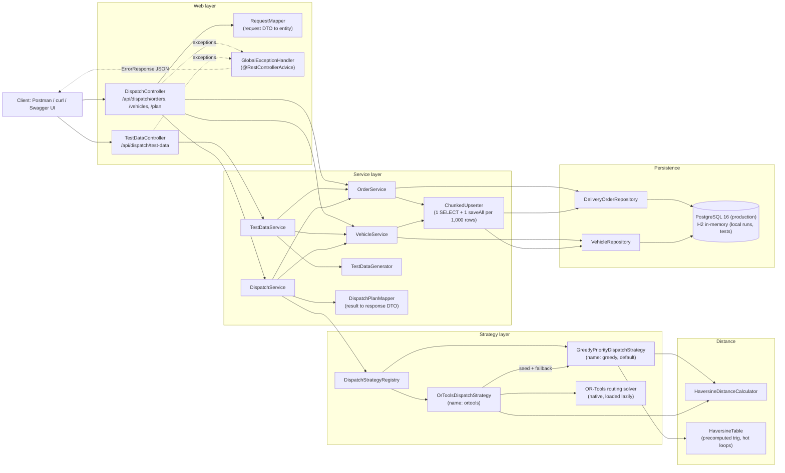

# Design and decisions

[Back to README](../README.md)

How the code is organised, which patterns it uses and why, and the assumptions behind its behaviour.

- [Architecture](#architecture)
- [Package structure](#package-structure)
- [Design patterns](#design-patterns)
- [Assumptions and decisions](#assumptions-and-decisions)
- [How the design scales](#how-the-design-scales)

## Architecture

An interactive version of the request-flow diagram is in [architecture.html](architecture.html)
(self-contained; download and open in a browser). The component view:



Request flow for `GET /api/dispatch/plan`: the controller passes the `strategy` parameter to
`DispatchService`, which resolves the strategy in the registry (unknown name: 400), loads vehicles
(none: 400) and orders, runs the algorithm outside any transaction, and maps the internal
`DispatchResult` to the response DTO. The plan is computed on demand and never persisted.

## Package structure

```
com.freightfox.dispatch
|-- DispatchLoadBalancerApplication   Spring Boot entry point (@ConfigurationPropertiesScan)
|-- config        Typed settings (DispatchProperties: app.dispatch.*, TestDataProperties: app.test-data.*) and OpenAPI metadata
|-- controller    Thin REST controllers, API paths/messages (ApiMessages) and Swagger examples (OpenApiExamples)
|-- distance      DistanceCalculator interface, HaversineDistanceCalculator, HaversineTable (trig-free hot-loop distances)
|-- dto
|   |-- request   Validated request records (OrdersRequest, OrderRequest, VehiclesRequest, VehicleRequest)
|   `-- response  Response records (StatusResponse, ErrorResponse, DispatchPlanResponse, VehiclePlanResponse, ...)
|-- entity        JPA entities DeliveryOrder and Vehicle (String primary keys, Persistable) and enum Priority
|-- exception     BadRequestException hierarchy, ErrorMessages constants, GlobalExceptionHandler, JSON error translation
|-- mapper        RequestMapper (DTO to entity) and DispatchPlanMapper (DispatchResult to response DTO)
|-- repository    Spring Data JPA repositories
|-- service       Service interfaces (OrderService, VehicleService, DispatchService) and UpsertResult
|   `-- impl      Default implementations and ChunkedUpserter (shared chunked upsert)
|-- strategy      DispatchStrategy contract, DispatchResult, VehicleRoute, UnassignedOrder, StrategyNames, UnassignmentReasons
|   |-- greedy    GreedyPriorityDispatchStrategy, CapacityAssigner, RouteOptimizer (nearest-neighbour + 2-opt), DispatchOrdering
|   |-- ortools   OrToolsDispatchStrategy, CvrpModelBuilder, CvrpModel, DropPenalties, OrToolsCvrpSolver, OrToolsNativeLoader, ...
|   `-- registry  DispatchStrategyRegistry (strategy lookup by name)
`-- testdata      TestDataGenerator (30 Indian cities, seeded Random), TestDataService, IndianCity
```

Conventions: constructor injection only, records for DTOs, all API strings in constants (`ApiMessages`,
`ErrorMessages`, `UnassignmentReasons`, `StrategyNames`), SLF4J logging, no JPA entity ever leaves the
service layer.

## Design patterns

| Pattern | Where |
|---|---|
| Strategy | `DispatchStrategy` with `GreedyPriorityDispatchStrategy` and `OrToolsDispatchStrategy`; `DistanceCalculator` with `HaversineDistanceCalculator`. |
| Registry | `DispatchStrategyRegistry` is built from every `DispatchStrategy` bean and looks them up by case-insensitive name. Adding an algorithm means adding one bean; there is no if/else on the strategy anywhere. |
| DTO + Mapper | Java records for requests and responses; `RequestMapper` and `DispatchPlanMapper` keep JPA entities out of the API. |
| Repository | Spring Data JPA `DeliveryOrderRepository` and `VehicleRepository`. |
| Template method (by composition) | `ChunkedUpserter` owns the fixed upsert algorithm (reject duplicates, then per chunk: one `findAllById`, merge, one `saveAll`, flush, clear); each service supplies a `ChunkedUpserter.Target`. |
| Fallback / graceful degradation | `OrToolsDispatchStrategy` receives the greedy strategy as its seed and fallback (cap, native load failure, busy, no solution, failed re-check or priority guard). |
| Bulkhead | A semaphore limits concurrent OR-Tools solves to 2; extra requests degrade to greedy instead of queueing. |
| Builder | `CvrpModelBuilder` assembles the immutable `CvrpModel` (node layout, metre matrix, demands, capacities, penalties). |
| Adapter / seam | `CvrpSolver` interface with `OrToolsCvrpSolver` adapting the OR-Tools routing API to plain Java `CvrpModel` / `CvrpSolution`; tests replace it to exercise every fallback. |
| Lazy initialization | `OrToolsNativeLoader` loads the native libraries on first use, once, thread-safe, and caches failure, so application start-up never depends on them. |
| Centralized error handling | One `@RestControllerAdvice` (`GlobalExceptionHandler`) and an exception hierarchy rooted at `BadRequestException`. |
| Null object / static factories | `VehicleRoute.empty(vehicle)` for unused vehicles; `StatusResponse.success(...)`, `ErrorResponse.of(...)`. |

## Assumptions and decisions

**Routes and distances**
- Routes are open: distance = vehicle location -> stop 1 -> ... -> last stop, with no return trip.
- Distances are great-circle (Haversine, R = 6371.0 km), not road distances; there are no time windows.
- The plan is computed on demand and never persisted.

**Input and validation**
- Weights and capacities are whole numbers (int, e.g. kg). `10.5` is rejected with 400 rather than
  truncated.
- `priority` is case-insensitive (`"high"` is accepted); a number such as `1` is rejected.
- Parsing is strict: numbers as strings, int overflow and trailing text after the JSON body are rejected.
- IDs and addresses are stored exactly as sent (case-sensitive IDs).
- Each POST is all-or-nothing: the whole batch is validated first and the upsert runs in one transaction.
- Error lists are capped at 100 entries; echoed values are truncated to 64 characters; validation errors
  are sorted alphabetically.

**Upsert semantics**
- POSTing an existing ID replaces all of its fields; new IDs are inserted; IDs not in the request are
  left untouched (POST is additive, not a full replacement). Use DELETE to clear.
- Chunks of 1,000: per chunk one `findAllById`, `updateFrom()` on the managed rows (dirty checking,
  batched UPDATEs), one `saveAll` of the new rows (batched INSERTs), then flush and clear. Entities
  implement `Persistable<String>`, so new rows are persisted without a SELECT per row. Hibernate JDBC
  batching: `batch_size` 50, `order_inserts`, `order_updates`. DELETE is one bulk statement.
- Two concurrent requests inserting the same new ID: one succeeds, the other gets 409 (the flush goes
  through the repository proxy so the constraint violation is translated, never a 500).

**Plan endpoint**
- Strategy lookup is case-insensitive and trimmed; null or blank means `greedy`.
- Check order: strategy first (unknown gives 400 even with an empty database), then vehicles (none
  gives 400 `No vehicles available for dispatch`), then orders (none gives 200 with every vehicle
  listed empty).

**Greedy**
- Sort by priority, then heavier first (reduces fragmentation), then `orderId`; nearest vehicle measured
  from its current route end; ties go to the smaller `vehicleId`.
- Deterministic, unless a 2-opt time budget runs out (only on very long routes).

**OR-Tools**
- Not strictly deterministic: the search is time-limited, so the plan can differ slightly between runs.
  The constraints (capacity, priorities, each order at most once) always hold.
- Greedy runs once per OR-Tools call; its plan seeds the search and is returned if OR-Tools would leave
  more HIGH (then MEDIUM, then LOW) orders unassigned.

**Test data**
- `POST /api/dispatch/test-data` replaces all stored orders and vehicles in ONE transaction, through the
  same services, so a concurrent plan sees either the old or the new dataset. Calls are serialized per
  instance. `elapsedMs` covers generate + clear + store, not planning.
- 30 real Indian city centres; points uniform within a 15 km disc; address `Near <City>, India`;
  priority 30% HIGH / 40% MEDIUM / 30% LOW; weight 1 to 50 and capacity 100 to 500; IDs
  `ORD000001...` and `VEH0001...`, which never collide with the sample IDs. Same seed, same data.

**Operations**
- Production runs on PostgreSQL 16 (`prod` profile, Render managed database). Local runs and the test
  suite use in-memory H2, so the project runs with nothing but a JDK.
- Flyway owns the schema (versioned migrations, primary keys, CHECK constraints) on both databases;
  Hibernate only validates it, so entity/schema drift stops the application at start-up.
- The OpenAPI server URL is relative (`/`), so Swagger "Try it out" works locally, in Docker and on
  Render; `forward-headers-strategy: framework` keeps redirects on HTTPS behind Render's proxy.
- Actuator exposes `health` only, without details.

## How the design scales

- **Chunked, batched upsert.** One `SELECT ... WHERE id IN (...)` per 1,000 rows, JDBC-batched INSERTs and
  UPDATEs (batch size 50), and a flush + clear after each chunk so the persistence context never holds
  more than one chunk. Unchanged rows produce no SQL.
- **Large requests accepted.** A 50,000-order JSON body (about 7 MB) is validated and upserted in one
  request (`LargeBatchIntegrationTest`). Error responses stay small because the error list is capped.
- **Allocation-free O(n * m) greedy.** Primitive arrays and precomputed trigonometry; the inner loop
  compares the Haversine term instead of kilometres (no allocation, no `sqrt`, no `asin`). Route
  improvement is bounded per vehicle, so planning time stays predictable at 50,000 x 500.
- **OR-Tools cap and bulkhead.** The solver matrix is `(V + N + 1)^2` and each solve occupies a core for
  the full time limit, so OR-Tools is limited to 1,000 orders and 2 concurrent solves; beyond that the
  service degrades to greedy rather than failing or queueing.
- **Responses** larger than 2 KB are gzip-compressed; the plan is computed outside any database
  transaction.
